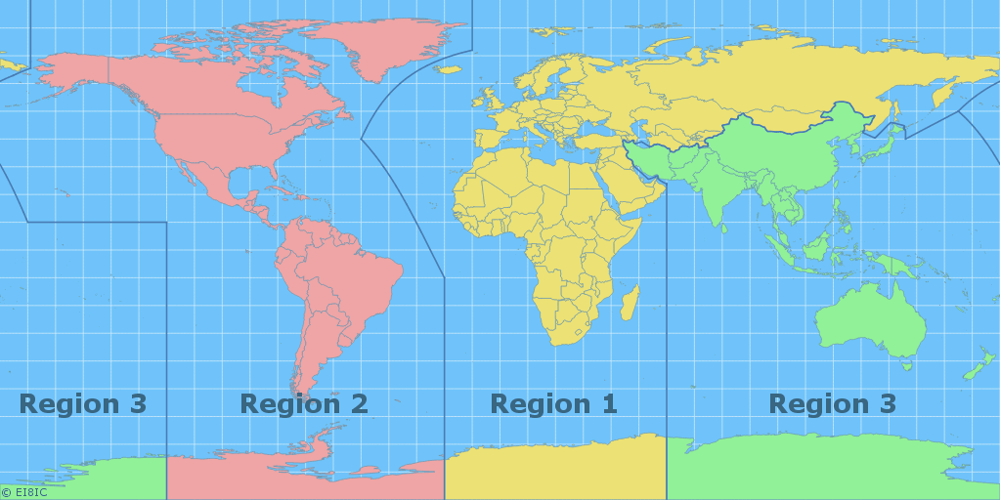

# Rozvrh kmitočtů a druhů provozu

Jak jsme již nastínili v předešlé kapitole, spojení na druhý konec planety je možné uskutečnit díky
práci našich předchůdců, kteří mají zásluhu na tom, že jsou **frekvenčni pásma používané radioamatéry z velké míry celosvětově koordinované**.

Rozvrh kmitočtů a druhů provozu stanovuje dokument spravovaný vždy regionální **Mezinárodní Radioamatérskou Unií (IARU)** a jmenuje se **Bandplan**. Než si o něm řekneme víc, musíme se nejdříve podívat na jednotlivé IARU regiony.

## Regiony IARU
Existují tři regionální organizace IARU, a každá má pod správou jasně danou zeměpisnou oblast:

- [Region 1](http://www.iaru-r1.org/) — Afrika, Evropa, Střední východ, and severní Asie
- [Region 2](http://www.iaru-r2.org/) — Amerika
- [Region 3](http://www.iaru-r3.org/) — zbytek Asie a Pacifik

Česká Republika tedy patří do regionu 1.

## IARU Bandplan
Každý IARU region má své vlastní bandplany - **rozpisy vyhrazených radioamatérských kmitočtů a druhů provozu**. 
Bandplanů je pro jeden konkrétní region více, protože se ještě dále dělí podle jednotlivých kmitočtů:

- Bandplan HF (HF z anglického high frequency - česky `krátké vlny`)
- Bandplan VHF (VHF z anglického very high frequency - česky `velmi krátké vlny`)
- Bandplan UHF (UHF z anglického ultra high frequency - česky `ultra krátké vlny`)
- Bandplan SHF (SHF z anglického super high frequency - česky `super krátké vlny`)
- Bandplan µWave (µWave - česky `mikrovlny`)

Aktuální verzi všech výše zmíněných bandplanů lze nalézt na webu IARU. Pro region 1 (kam spadá ČR) jsou k dispozici na tomto odkazu: [IARU - Region 1 Band Plans](https://www.iaru-r1.org/reference/band-plans/).

Bandplany jednotlivých regionů se v některých věcech liší, ale zpravidla lze vždy nalézt průnik v kmitočtech a druzích provozu ve všech regionech - díky tomu můžeme mluvit s radioamatéry nacházejícími se v jiném IARU regionu, než jsme my sami. 

## Rozvrh radioamatérských kmitočtů v ČR
V ČR jsou radioamatérské kmitočty, druhy provozu a povolené výkony, definované v [Příloze č. 1 vyhlášky č. 156/2005 Sb.](https://www.zakonyprolidi.cz/cs/2005-156#f5769053). Kmitočty a výkony jsou rozdělené dle operátorských tříd a až na drobné výjímky odpovídají téměř přesně bandplanu IARU pro region 1.

::: info Poznámka
Každá země totiž může provozovat na svém území rádiové služby, které se s radioamatérskými pásmy překrývají a mají vyšší prioritu, než radioamatérský provoz. Kmitočtové rozsahy v bandplanech IARU jsou tedy používány jako základ, který je pak transponován do národní legislativy s ohledem na tyto prioritní služby. 
:::

## Otázky ke zkoušce 🎓

#### Třída A (HAREC)
- [Testové otázky HAREC z kategorie Rozvrh kmitočtů a druhů provozu](https://hamotazky.cz/harec/prohlizeni/kmitocty-a-druhy-provozu)

#### Třída N (NOVICE)
- [Testové otázky NOVICE z kategorie Rozvrh kmitočtů a druhů provozu](https://hamotazky.cz/novice/prohlizeni/kmitocty-a-druhy-provozu)
